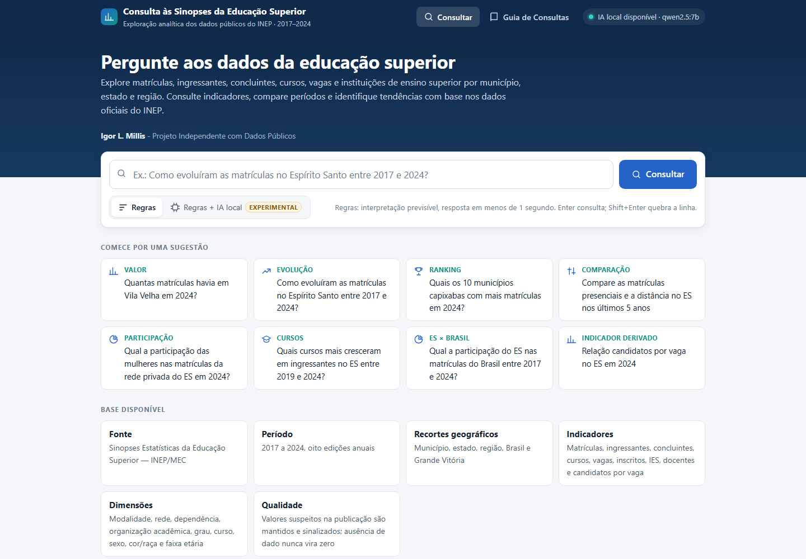
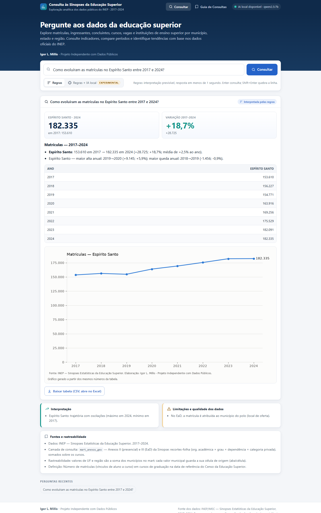
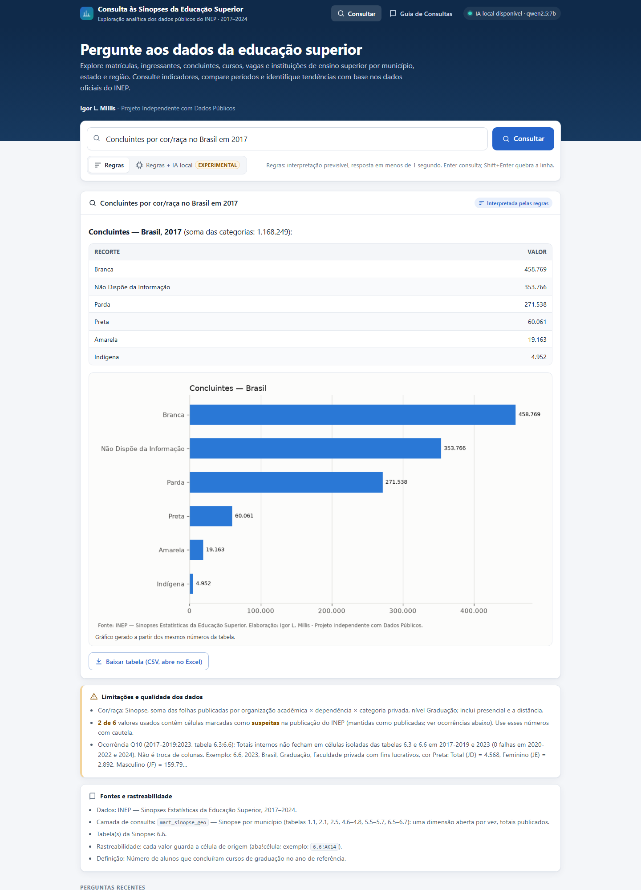
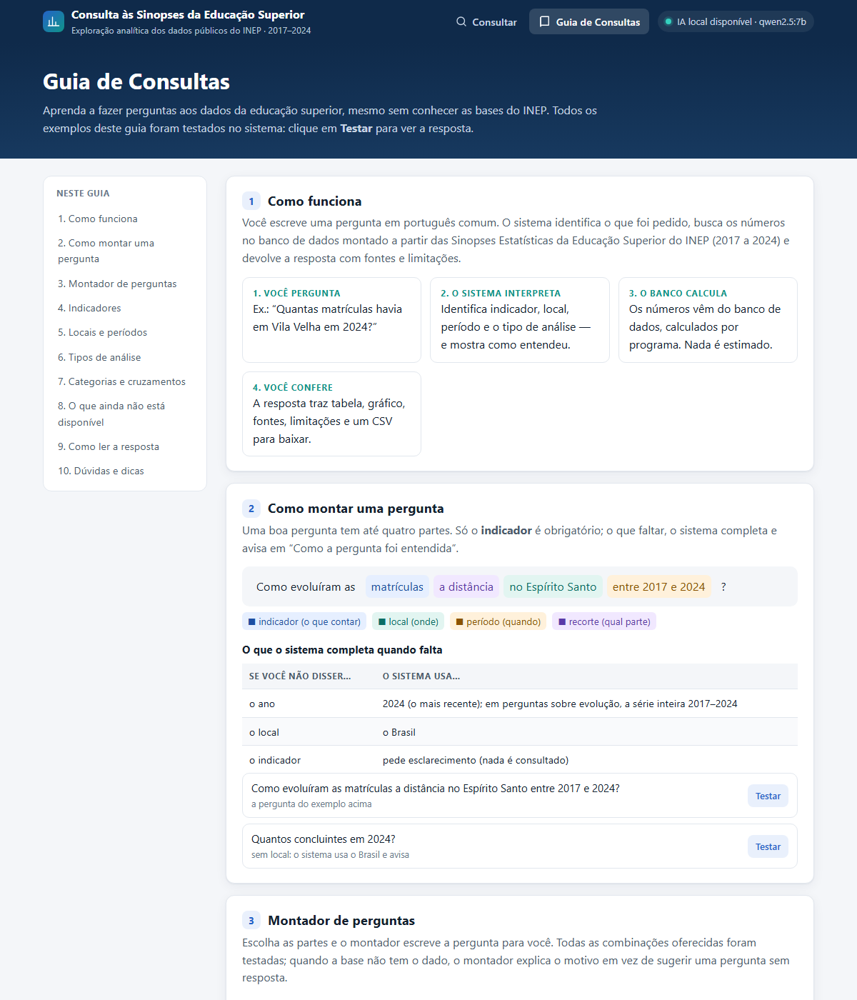

# Consulta às Sinopses da Educação Superior (INEP), 2017–2024

**Igor L. Millis - Projeto Independente com Dados Públicos**

Explore matrículas, ingressantes, concluintes, cursos, vagas e instituições de ensino superior por município, estado e região. Consulte indicadores, compare períodos e identifique tendências com base nos dados oficiais do INEP.

Fonte dos dados: INEP/MEC — Sinopses Estatísticas da Educação Superior, 2017–2024. Processamento e consultas realizados localmente. Inconsistências identificadas na publicação original são preservadas e sinalizadas nas respostas.



## O que é

Uma ferramenta local para fazer perguntas em português sobre as oito edições (2017–2024) das Sinopses Estatísticas da Educação Superior do INEP:

> *Como evoluíram as matrículas no Espírito Santo entre 2017 e 2024?* · *Quais os 10 municípios capixabas com mais matrículas em 2024?* · *Qual a participação das mulheres nas matrículas da rede privada do ES?*

- **Números calculados pelo banco, não estimados.** Um interpretador por regras transforma a pergunta numa consulta estruturada. O SQL é montado com parâmetros e roda num banco DuckDB aberto **somente para leitura**.
- **Rastreabilidade até a célula:** cada valor guarda a aba e a célula da planilha original do INEP de onde veio.
- **Honestidade sobre os dados:**
  - inconsistências da própria publicação (ocorrências Q01–Q13) são mantidas como publicadas e sinalizadas;
  - ausência de dado nunca vira zero;
  - perguntas sobre o que a base não tem recebem uma explicação, não um número inventado.
- **Interface web local** (só biblioteca padrão do Python) com gráficos, tabelas, exportação CSV e uma aba **Guia de Consultas** interativa.
- **IA local opcional (experimental):** um modelo de linguagem rodando no próprio computador (Ollama + Qwen2.5 7B) ajuda a interpretar perguntas que as regras não entendem. Ele nunca gera SQL nem números.
- **100% local:** nenhum dado é enviado a serviços externos.

| Resposta com série histórica | Sinalização de qualidade | Guia de Consultas |
|---|---|---|
|  |  |  |

## Os dados não estão neste repositório

O banco (`dados/nucleo/ijsn.duckdb`, cerca de 4,5 GB) e os ZIPs originais do INEP (cerca de 2,2 GB) passam dos limites do GitHub e estão no `.gitignore`. O banco pode ser **reconstruído do zero** a partir dos arquivos públicos:

1. Baixe as 8 Sinopses (2017–2024) do portal do INEP, salvando-as na raiz do projeto com os nomes `sinopse_educacao_superior_<ano>.zip`. Os endereços e o MD5 esperado de cada arquivo estão em [`config/manifesto_fontes.csv`](config/manifesto_fontes.csv).
2. Rode o pipeline na ordem descrita em [`pipeline/README.md`](pipeline/README.md) (cerca de 3 horas e 6 GB de RAM livres na carga mais pesada).

## Instalação

Requer **Windows** e **Python 3.12**.

```bash
py -3.12 -m pip install -r requirements.txt
```

## Uso

**Interface (sem programar):** dois cliques em `iniciar_interface.bat`. O navegador abre em `http://127.0.0.1:8765`. Guia para usuários: [`MANUAL_USUARIO.md`](MANUAL_USUARIO.md).

**Linha de comando:**

```bash
py -3.12 -I perguntar.py "Quantas matrículas havia em Vila Velha em 2024?"
```

**Em Python:**

```python
from motor import perguntar
r = perguntar("Compare as matrículas presenciais e a distância no ES nos últimos 5 anos")
print(r.texto)      # resposta em markdown: resultado, interpretação, fontes, limitações
r.tabela            # DataFrame com os números
```

O `iniciar_interface.bat` procura o Python em `%LOCALAPPDATA%\Programs\Python\Python312` (instalação padrão do python.org). Para levar a ferramenta a outro computador, use um pacote com o banco, um iniciador que localiza o Python e um verificador de ambiente. A pasta local `Portabilidade do Projeto/`, não versionada, segue esse modelo.

## Testes

```bash
py -3.12 -I -m pytest -p no:cacheprovider tests
```

São **458 testes** (precisam do banco). Eles cobrem:
- segurança do SQL;
- interpretação, com um gabarito de 61 perguntas revisadas;
- respostas comparadas com consultas independentes nas tabelas de fato;
- regressões, qualidade dos dados e interface;
- IA local, com o modelo simulado;
- todos os exemplos e as 150 combinações do montador do Guia de Consultas.

O pipeline tem validações próprias (`pipeline/p*_validar.py`), por exemplo a conferência de valores no XML original das planilhas.

## Arquitetura

```
ZIPs do INEP ─► P0 staging (Parquet, cópia fiel) ─► P1–P3 núcleo DuckDB (fatos com status e origem por célula)
            ─► P4 correspondências entre anos ─► P5 visões ─► P6 marts (camada de consulta validada)
pergunta ─► interpretador (regras | IA local opcional) ─► contrato JSON validado ─► SQL parametrizado, somente leitura
        ─► análise em código (variação, participação, ranking…) ─► resposta: texto, tabela, gráfico, fontes, limitações
```

| Pasta | Conteúdo |
|---|---|
| [`app/`](app) | Interface web local (`servidor.py`, `pagina.html`) |
| [`motor/`](motor) | Motor de consultas: interpretador, catálogo semântico, segurança, análise, resposta, IA local ([manual técnico](motor/README.md)) |
| [`pipeline/`](pipeline) | Construção e validação do banco, P0–P6 ([ordem de execução](pipeline/README.md)) |
| [`config/`](config) | Mapeamentos de colunas, correções manuais, ocorrências de qualidade, manifesto das fontes |
| [`tests/`](tests) | Testes automatizados, bateria de perguntas, avaliação da IA, teste ponta a ponta |
| [`_arquitetura/`](_arquitetura) | Arquitetura de dados, registro de decisões (D01–D18), proposta de LLM |
| [`_diagnostico_estrutura/`](_diagnostico_estrutura) | Diagnóstico da estrutura das 662 abas das planilhas |
| [`docs/img/`](docs/img) | Capturas de tela |

Documentos de acompanhamento: [`ACOMPANHAMENTO.md`](ACOMPANHAMENTO.md) (histórico de desenvolvimento) e [`RELATORIO_FINAL_AUDITORIA.md`](RELATORIO_FINAL_AUDITORIA.md).

## Princípios

Originais intocados · nada é corrigido em silêncio (valores suspeitos são marcados e explicados) · ausência ≠ zero · comparações entre anos só com compatibilidade verificada · processamento 100% local, com ferramentas gratuitas · toda funcionalidade com teste executado e registrado.

## Limitações conhecidas

- Indicadores de deficiência, reserva de vagas (cotas), financiamento, turno, nacionalidade e titulação de docentes existem na base, mas ainda não estão disponíveis no motor.
- As Sinopses não publicam taxas de evasão ou conclusão por coorte. Cursos, vagas e inscritos a distância só existem no total Brasil.
- O interpretador por regras cobre as formas de pergunta documentadas no Guia. A IA local é experimental: sozinha, acertou 27 de 40 perguntas na avaliação.

## Autoria e relação com o IJSN

Este projeto foi idealizado e desenvolvido por mim, de forma **independente**, em paralelo à bolsa de pesquisa no Instituto. **Não é um produto, sistema ou publicação oficial do IJSN**, não tem endosso do Instituto, e a responsabilidade pelo conteúdo é exclusivamente do minha. Os dados são públicos e foram obtidos diretamente do INEP/MEC.

O nome `ijsn` aparece no arquivo do banco (`ijsn.duckdb`), na pasta temporária `ijsn_pipeline` e em alguns caminhos. É apenas uma menção de agradecimento. 
